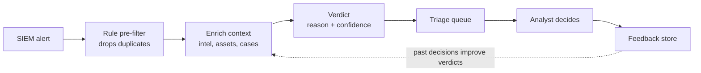

# CyberShield: Product Strategy

**Author:** Mayank Udaywal · **Last updated:** Oct 2026

> Portfolio exercise built on a Coursera product management case study. The case describes a 12-month launch under tight resources and a new competitor (GuardWare) but skips the hard choices. This doc makes them. GuardWare details, team costs, pricing and all targets are planning assumptions, not sourced figures.

## Executive summary

CyberShield is an AI triage copilot for mid-market security teams and MSSPs. It reads every alert, matches it against threat intelligence and the customer's own environment, and tells the analyst which alerts are real, why, and what to do next.

**The one bet:** GuardWare and most incumbents sell more threat data. Analysts already drown in data. CyberShield sells fewer, better decisions. We win on time-to-decision per alert, not on feed size.

| Question | Answer |
| --- | --- |
| Who buys | Head of SecOps or CISO at 500–5,000 employee companies, plus MSSPs running SOCs for many clients |
| Who uses | Tier 1 and Tier 2 SOC analysts |
| Painful problem | Too many alerts, most of them false positives, real threats missed in the noise |
| Why AI | Triage needs reading unstructured context (logs, intel, past cases) at a volume no human team can match |
| Why now | A competitor just launched, analyst shortages are worsening, and language models can now explain a verdict in plain language |
| Constraint | 12 months to market, limited engineers, extra budget only with data |

## Problem and users

Security teams don't lack threat data. They lack time to turn alerts into decisions.

**Evidence** ([Abnormal AI, citing an OMDIA survey of 491 security decision makers](https://abnormal.ai/learning/alert-fatigue-cybersecurity)):

- 49% of SOC analysts name alert fatigue as their biggest challenge
- 60–70% of alerts end up classified as benign
- One medium-to-high severity alert takes 15–20 minutes to triage manually
- AI-assisted triage has cut that to 3–4 minutes per alert
- 75% of analysts say they have no time for strategic work like threat hunting

### Personas

| Persona | Role | Job to be done | Top pain | What they pay for |
| --- | --- | --- | --- | --- |
| Priya, Tier 1 analyst | Works the alert queue | Clear the queue without missing a real attack | 150+ alerts a day, most noise, no context | Doesn't pay. Adoption depends on her trust in the verdicts |
| Daniel, Head of SecOps | Runs a 4–8 person SOC | Cover more threats without hiring more analysts | Can't hire fast enough, analysts quit from burnout | Analyst hours saved, lower time to respond |
| Meera, CISO | Reports risk to the board | Prove security spend reduces risk | Board asks for numbers she doesn't have | Risk metrics and a clean audit story |
| Rahul, MSSP SOC lead | Runs SOC for 30+ client companies | Serve more clients per analyst | Margin falls as alert volume grows | Clients per analyst, gross margin |

**Primary target for v1:** Daniel at mid-market companies. He feels the pain daily, owns the budget line, and can approve a pilot without a 9-month procurement cycle. MSSPs are the Phase 3 expansion market.

## Market and competition

**Market size** ([Fortune Business Insights, Oct 2026](https://www.fortunebusinessinsights.com/threat-intelligence-market-102984)):

- Global threat intelligence market: USD 6.87B in 2025, USD 8.22B in 2026, projected USD 31.58B by 2034 (18.3% CAGR)
- North America holds 44.7%, cloud deployment 65.67%
- SMEs are the fastest-growing segment
- Lack of skilled analysts is named as the main brake on the market

Other research firms size 2026 anywhere from about USD 8B to USD 19B depending on scope. Treat the number as directional. The growth rate and the SME shift are what matter here.

| Player type | Examples | What they sell | Weakness CyberShield exploits |
| --- | --- | --- | --- |
| Enterprise platforms | CrowdStrike, IBM, Check Point, Cisco | Threat intel bundled into a large suite | Priced and built for large enterprises, long rollouts |
| Threat intel platforms | Anomali, Kaspersky | Aggregated feeds and indicators | Add more data to an already overloaded analyst |
| AI SOC startups | Many new entrants | Autonomous alert investigation | Trust gap, black-box verdicts |
| GuardWare (case study) | New launch | Assumed: broad threat-feed platform | See below |

### GuardWare teardown (assumptions to validate in the first 4 weeks)

| Dimension | GuardWare (assumed) | CyberShield response |
| --- | --- | --- |
| Core promise | More and fresher threat data | Fewer alerts that need a human |
| Buyer | Large enterprise CISO | Mid-market Head of SecOps |
| Time to value | Weeks of integration | First triaged alerts within 1 day |
| AI role | Enrichment and tagging | Verdict + plain-language reason |
| Proof metric | Feed coverage | Analyst minutes saved per alert |

**Strategic call:** don't match GuardWare feature for feature. A smaller team chasing parity loses. Own one painful job (triage) for one buyer (mid-market SecOps) and get there first with proof.

## Positioning

**Vision:** every security team, whatever its size, can act on the threats that matter within minutes, not hours.

**Positioning:** For mid-market security teams drowning in alerts, CyberShield is a triage copilot that tells analysts which alerts are real and why. Unlike threat-feed platforms that add more data, CyberShield removes work.

**What it deliberately does not do in v1:** no autonomous blocking or remediation, no auto-closing alerts, no replacing the SIEM. In security, one wrong auto-action costs more than a hundred hours saved.

## MVP scope and prioritisation

**RICE:** Reach (% of pilot users weekly) × Impact (0.5–3) × Confidence ÷ Effort (person-months).

| Feature | Reach | Impact | Confidence | Effort | RICE | Decision |
| --- | --- | --- | --- | --- | --- | --- |
| Analyst feedback (agree / disagree + reason) | 100 | 2 | 80% | 1 | 160 | MVP |
| SIEM connector (Splunk, Sentinel) | 100 | 3 | 90% | 3 | 90 | MVP |
| Triage queue sorted by verdict | 100 | 2 | 90% | 2 | 90 | MVP |
| Threat intel enrichment | 80 | 2 | 80% | 2 | 64 | MVP |
| Verdict + plain-language explanation | 100 | 3 | 70% | 4 | 52.5 | MVP (core) |
| Weekly time-saved report | 30 | 2 | 80% | 1 | 48 | MVP |
| Auto-close likely-benign alerts | 100 | 3 | 30% | 3 | 30 | Phase 2, gated on accuracy |
| Recommended next step | 80 | 1 | 60% | 2 | 24 | Phase 2 |
| More SIEM connectors | 40 | 1 | 80% | 3 | 10.7 | Phase 3 |
| Auto-remediation | 60 | 3 | 20% | 5 | 7.2 | Cut |
| Multi-tenant MSSP console | 20 | 2 | 50% | 4 | 5 | Phase 3 |
| Custom model per customer | 50 | 1 | 30% | 6 | 2.5 | Cut |

The verdict feature scores fifth only because it's the hardest to build. Without it there's no product. RICE orders the work around the core. It doesn't decide whether the core exists.

## AI system design

### The error tradeoff

The two mistakes aren't equal. Calling a real attack benign can mean a breach. Calling a benign alert suspicious costs an analyst 15 minutes. So the system is tuned to almost never miss a real attack, even if fewer alerts get cleared.

| Engine says → / Reality ↓ | Likely malicious | Likely benign |
| --- | --- | --- |
| Actually malicious | Correct catch | **Missed attack. Worst outcome. Target under 2%** |
| Actually benign | Wasted analyst time. Acceptable | Correct, time saved |

### Evaluation plan

| Eval | How | Target (v1) |
| --- | --- | --- |
| Recall on malicious alerts | Golden set of ~2,000 labelled historical alerts | ≥ 98% |
| Benign alerts correctly cleared | Same golden set | ≥ 50% |
| Explanation faithfulness | Senior analysts grade 100 explanations a month | ≥ 90% |
| Analyst agreement | Live feedback buttons | ≥ 85% |
| Prompt injection resistance | Attacker text planted in logs | 0 successful flips |
| Latency and cost | Production monitoring | < 30 s and < USD 0.05 per alert |

In security, the attacker controls part of the input. That's why prompt injection is a release gate, not a nice-to-have.

## Success metrics

**North star:** analyst hours returned per customer per week, with zero increase in missed attacks. The guardrail stops the team from gaming the north star by clearing alerts recklessly.

| Layer | Metric | Target by Month 12 |
| --- | --- | --- |
| North star | Analyst hours returned per customer per week | ≥ 20 for a 5-analyst SOC |
| Guardrail | Recall on malicious | ≥ 98% |
| AI quality | Analyst agreement | ≥ 85% |
| AI quality | Median triage time per alert | Under 5 min |
| Product | Weekly active analysts / licensed | ≥ 70% |
| Business | Design partners signed | 5 by Month 3 |
| Business | Paying customers at launch | 10 |

**Not optimised for:** total alerts processed. It's a vanity number that rises with noise.

## 12-month roadmap

| Phase | Months | Product (Sarah) | Project (Alex) | Exit gate |
| --- | --- | --- | --- | --- |
| Discover | 1–3 | Talk to 15 SOC leads, sign 5 design partners, label 2,000 alerts | Hire 3 specialists, plan and milestones, data-sharing terms | 5 partners signed, golden set ready |
| Alpha | 4–5 | Verdict + explanation, queue, feedback, offline evals | SIEM connectors, red-team plan, cost tracking | **≥ 98% recall → budget tranche 2 released** |
| Beta | 6–9 | 15 beta customers, weekly agreement data, pricing tests | Scale infra and QA, SOC 2 Type I, scope control | ≥ 85% agreement, ≥ 70% weekly active |
| Launch | 10–12 | GA positioning, case studies, Phase 2 backlog | Launch readiness, release and rollback, SLAs | 10 paying customers, 20+ hours saved per week |

## Budget ask

About USD 0.73M extra, released in two tranches tied to proof.

| Item | Assumption | Cost (USD) |
| --- | --- | --- |
| 2 AI/ML engineers | ~220K fully loaded each, 9 months | 330,000 |
| 1 detection engineer | ~180K fully loaded, 9 months | 135,000 |
| Golden-set labelling | 2,000 alerts × 20 min × ~100/hr | 67,000 |
| LLM inference during beta | 15 customers × ~1,000 alerts/day × 0.05 × 180 days | 135,000 |
| Commercial threat feed | 1 vendor, annual | 60,000 |
| **Total** | | **≈ 727,000** |

| Tranche | Amount | Released when |
| --- | --- | --- |
| 1 | ~USD 0.33M | Approved now |
| 2 | ~USD 0.40M | Alpha hits ≥ 98% recall AND 5 design partners signed |

If the Month 5 gate fails, the team stops or pivots having spent under half. Leadership isn't betting the full amount on an unproven model.

**Why it pays back:** 20 analyst hours saved per week × 52 × ~USD 60/hr ≈ USD 62K of capacity per customer per year, which supports a USD 30–40K annual price.

## Risks

| Risk | Likelihood | Impact | Mitigation | Owner |
| --- | --- | --- | --- | --- |
| AI misses a real attack | Medium | Severe | Recall-first tuning, low confidence routes to a human, no auto-close | Sarah |
| Analysts ignore verdicts | High | High | Evidence on every verdict, weekly agreement tracking, co-design with partners | Sarah |
| Prompt injection via log text | Medium | Severe | Logs treated as data, red-team every release, structured outputs | Alex |
| Not enough labelled data | High | High | Data-sharing terms with design partners, labelling budget | Sarah |
| Hiring takes too long | Medium | High | Hire from Week 1, contractors as bridge | Alex |
| GuardWare moves downmarket | Medium | High | Speed to proof, publish time-saved case studies early | Sarah |
| LLM cost above USD 0.05 per alert | Medium | Medium | Rule pre-filter, smaller model for easy cases | Alex |
| Data concerns block deals | Medium | High | Tenant isolation, no cross-customer training, SOC 2 | Alex |
| Scope creep | High | Medium | Public cut list, every ask goes through RICE | Sarah + Alex |

## Sources

- Case study: "CyberShield", Matt Versdahl and Daniel Yeomans, Coursera course material
- [Threat Intelligence Market, Fortune Business Insights (Oct 2026)](https://www.fortunebusinessinsights.com/threat-intelligence-market-102984)
- [Alert Fatigue: The Hidden Cost Draining Your SOC, Abnormal AI (Jan 2026)](https://abnormal.ai/learning/alert-fatigue-cybersecurity)
